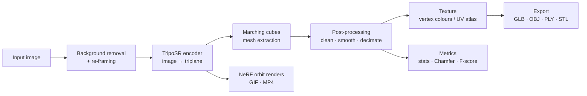

# Single Image → 3D Reconstruction

[](https://colab.research.google.com/github/YOUR_USERNAME/single-image-to-3d/blob/main/notebooks/single_image_to_3d_research.ipynb)
[](LICENSE)

A reproducible, research-oriented Google Colab notebook that turns **one photo** into a **3D mesh** with a feed-forward Large Reconstruction Model ([TripoSR](https://github.com/VAST-AI-Research/TripoSR)) and adds the tooling researchers usually have to build themselves: mesh cleanup, texture baking, evaluation metrics, batch benchmarking and ablation sweeps.

---

## Features

| Area | Details |
|---|---|
| **Preprocessing** | Background removal with `rembg`, or reuse your own RGBA alpha; automatic foreground re-framing |
| **Reconstruction** | Triplane encoding + marching-cubes extraction at 128–512 resolution, configurable density threshold |
| **Post-processing** | Largest-component filter, hole filling, normal repair, Taubin smoothing, quadric decimation with colour transfer |
| **Texturing** | Vertex colours (default) or UV-baked texture atlas via `xatlas` |
| **Visualisation** | Turntable GIF/MP4, contact sheet, interactive Plotly 3D viewer |
| **Evaluation** | Mesh stats, Chamfer-L1/L2, F-score@τ vs ground truth (24-rotation + ICP alignment), best-view SSIM/PSNR |
| **Experiments** | Folder batch → CSV, resolution × framing ablation, threshold sweep, time & peak-VRAM logging |
| **Reproducibility** | Seeds, one `Config` dataclass, per-run `metadata.json` with versions, GPU, git commit, input hash |
| **Demo** | Optional Gradio web app with a shareable link |
| **Export** | GLB, OBJ, PLY, STL, textured OBJ + PNG, zipped results |

## Pipeline



## Quick start

1. Click the **Open in Colab** badge.
2. `Runtime → Change runtime type → T4 GPU` (or better).
3. Run cells from top to bottom (`Runtime → Run all` works with the default sample image).
4. Download the zip from section 9.

## Step-by-step guide

### 1 · Environment
- **1.1** prints Python, PyTorch, CUDA and GPU info. Warns if no GPU is attached.
- **1.2** installs dependencies and clones the TripoSR source (≈2–4 min).
- **1.3** installs `torchmcubes`. If the CUDA build fails, a scikit-image fallback is installed automatically.

### 2 · Configuration
- **2.1** is a form with every knob (see [parameters](#-parameters)). All values are stored in a `Config` dataclass and saved with each run.
- **2.2** optionally mounts Google Drive so outputs survive session resets.

### 3 · Load the model
Downloads `stabilityai/TripoSR` from Hugging Face and moves it to the GPU.

### 4 · Core library
Reusable functions: preprocessing, encoding, mesh extraction, post-processing, texture baking, rendering, viewers, metrics and the `run_pipeline()` runner. Import or copy them into your own experiments.

### 5 · Choose an input
Pick `sample`, `upload`, `url` or `path`. Best results come from a single, centred, fully visible object with an uncluttered background and even lighting.

### 6 · Reconstruct
- **6.1** runs the full pipeline and shows the input/processed images, timings, metrics, orbit renders, a turntable video and an interactive 3D viewer.
- **6.2** (optional) compares the result with a ground-truth mesh and reports Chamfer and F-score.

### 7 · Experiments
- **7.1** batch-processes a folder and writes `batch_results.csv`.
- **7.2** sweeps foreground ratio × marching-cubes resolution and plots mesh complexity and runtime.
- **7.3** compares density thresholds side by side.

### 8 · Web demo
Launches a Gradio app and prints a public link.

### 9 · Package results
Zips the run folder (or the whole output directory) and triggers a download.

## Parameters

| Parameter | Default | Effect |
|---|---|---|
| `REMOVE_BACKGROUND` | `True` | Segment the object with rembg (skipped if the image has a useful alpha) |
| `FOREGROUND_RATIO` | `0.85` | Fraction of the canvas the object occupies after re-framing |
| `MC_RESOLUTION` | `256` | Marching-cubes grid size; higher means more detail, more memory |
| `MC_THRESHOLD` | `25.0` | Density iso-level; lower inflates, higher erodes the surface |
| `CHUNK_SIZE` | `8192` | Renderer chunk size; lower it to save VRAM |
| `KEEP_LARGEST_COMPONENT` | `True` | Remove floating fragments |
| `FILL_HOLES` | `True` | Close small holes |
| `TAUBIN_SMOOTH_ITERS` | `0` | Volume-preserving smoothing iterations |
| `DECIMATE_TO_FACES` | `0` | Target face count (0 = off) |
| `BAKE_TEXTURE` | `False` | Export a UV-mapped textured OBJ and PNG |
| `RENDER_VIEWS` | `36` | Orbit frames for the turntable (0 = skip) |
| `VIEWER_ORIENTATION` | `True` | Rotate exports to a Y-up convention for GLB viewers |

## Outputs

Each run creates `outputs/<name>_<timestamp>/`:

```
input_original.png      input_processed.png
mesh.glb  mesh.obj  mesh.ply  mesh.stl
mesh_textured.obj + texture.png     (if BAKE_TEXTURE)
turntable.gif  turntable.mp4
metadata.json           (config, timings, metrics, environment, input SHA-256)
```

## Evaluation notes

- **Chamfer / F-score** operate on unit-normalised meshes; the prediction is aligned to the ground truth by trying all 24 axis-aligned rotations followed by ICP. τ is a fraction of the object's largest extent.
- **Best-view SSIM/PSNR** compares the processed input with the best-matching NeRF orbit frame. Camera conventions differ from your photo, so use it to compare settings against each other, not as an absolute score.
- For published results, report the `metadata.json` of each run and fix the seed.

## Troubleshooting

| Symptom | Fix |
|---|---|
| `torchmcubes` build fails | Automatic fallback is used. Check orientation in the 3D viewer |
| CUDA out of memory | Lower `CHUNK_SIZE` and `MC_RESOLUTION` |
| Empty-mesh error | Lower `MC_THRESHOLD`, raise `FOREGROUND_RATIO`, check the segmentation |
| Texture baking fails | Headless OpenGL is unavailable; keep vertex colours |
| Import errors after install | Restart the session and re-run from 1.2 |

## Limitations

- Single-view reconstruction hallucinates unseen sides; thin structures and fine detail are approximate.
- Best for isolated, object-centric images. Cluttered scenes, transparent objects and humans in complex poses are out of distribution.
- Meshes have arbitrary scale.

## Roadmap ideas

- Additional backends (Stable Fast 3D, InstantMesh, Hunyuan3D) behind the same `encode / extract_mesh` interface
- Multi-view consistency and CLIP-score evaluation
- Gaussian-splat export

## Citation

```bibtex
@article{TripoSR2024,
  title   = {TripoSR: Fast 3D Object Reconstruction from a Single Image},
  author  = {Tochilkin, Dmitry and Pankratz, David and Liu, Zexiang and Huang, Zixuan and Letts, Adam and Li, Yangguang and Liang, Ding and Laforte, Christian and Jampani, Varun and Cao, Yan-Pei},
  journal = {arXiv preprint arXiv:2403.02151},
  year    = {2024}
}
```

## License

This repository is released under the MIT License. TripoSR, rembg and their model weights have their own licences; please review them before commercial use.
